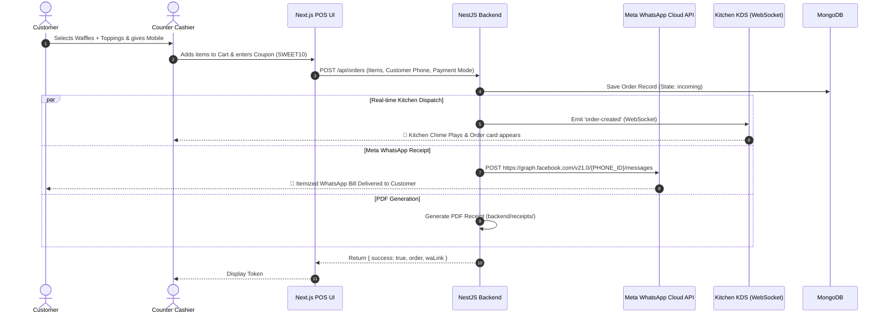

# 🧇 MOKKO Shop Management System
### *Enterprise QSR POS, Kitchen Kanban, WhatsApp Cloud Billing & ERP Platform*

---

## 📖 Chapter 1: The Story — "A Day at MOKKO"
*Imagine explaining this system to your friend or potential buyer over a cup of coffee. Here is how their cafe runs smoothly from morning to night with this software:*

---

### 🌅 Scene 1: Morning 09:00 AM — Instant Station Unlock with Security PIN
> **Cast**: **Priya** (Counter Cashier) & **Ron** (Shop Owner)

1. Priya arrives at the cafe, opens the counter tablet, and navigates to the POS screen (`http://localhost:3000/login`).
2. She selects her station (**Billing Counter**), enters her name `Priya`, and types the station PIN: `1234` (or master password `mokko123`).
3. She clicks **Unlock Counter Station**.
4. The system validates the PIN locally in milliseconds with zero reliance on external WhatsApp or SMS services.
5. The backend automatically registers Priya as **On Shift** in the Staff Directory, recording her clock-in time (`09:00 AM`).

---

### 🧇 Scene 2: Afternoon 02:30 PM — The Customer Order & Smart Discount
> **Cast**: **Rohan** (Walk-in Customer) & **Priya** (Counter Cashier)

1. Rohan walks up to the counter: *"I'd like 2 Belgian Dark Chocolate Waffles with extra strawberries, and 1 Nutella Brownie Shake."*
2. Priya taps the menu categories on the intuitive POS:
   - Taps **Waffles** ➔ selects **Belgian Dark Chocolate Waffle** (Qty: 2).
   - Customizes with the **Extra Strawberries** topping.
   - Taps **Beverages** ➔ selects **Nutella Brownie Shake** (Qty: 1).
3. Rohan mentions: *"Hey, do you have any offers today?"*
4. Priya enters coupon code **`SWEET10`** into the POS coupon bar.
   - The backend validates the code instantly, applying a 10% discount (`-₹48.00`).
   - The system automatically calculates **CGST (2.5%)** and **SGST (2.5%)** on the post-discount taxable amount.
5. Priya enters Rohan's phone number `98765 43210` for his customer CRM record and loyalty points.
6. Rohan pays via **UPI / Cash**. Priya clicks **Complete Order**.

---

### 📄 Scene 3: Instant Local PDF Archival & Backend Database Storage
> **Cast**: **POS Counter** & **Backend Database Engine**

The moment Priya clicks **Complete Order**, the backend performs two parallel actions in under 200ms:

1. **Complete Database Persistence**:
   The order is permanently saved to the backend database (MongoDB and in-memory store) with full item breakdown, timestamp, payment method, and tax details.
2. **Local PDF Receipt Generation**:
   A clean, professional PDF thermal receipt is generated and saved under `backend/receipts/`.
   The counter screen displays:
   `"💾 Order stored in backend database & receipt archived locally"`.
   Staff can click **"📄 View / Print Local PDF Receipt"** to open or print the thermal bill immediately for the customer.

The moment Priya clicks **Complete Order**, the backend performs three parallel actions in under 400ms:

1. **Meta WhatsApp Cloud Dispatch**:
   The backend connects to Meta Graph API (`https://graph.facebook.com/v21.0/{PHONE_ID}/messages`) using the shop's free tier (1,000 free conversations per month).
   Rohan receives an itemized WhatsApp receipt:
   ```text
   🧇 *MOKKO WAFFLES & MORE*
   ----------------------------------------
   *Order:* #ORD-1042  (Token #14)
   *Type:* Takeaway
   *Date:* 21/10/2026, 02:32 PM
   *Customer:* Rohan (+91 9876543210)
   ----------------------------------------
   2x Belgian Dark Chocolate Waffle - ₹360.00
      + Extra Strawberries (₹30.00)
   1x Nutella Brownie Shake - ₹180.00
   ----------------------------------------
   Subtotal:  ₹570.00
   Discount:  -₹48.00 (SWEET10)
   CGST 2.5%: ₹13.05
   SGST 2.5%: ₹13.05
   *TOTAL AMOUNT: ₹548.10*
   *Payment Mode: UPI (PAID)*
   ----------------------------------------
   Thank you for visiting MOKKO! 🧇 Come back soon!
   ```
2. **Guaranteed Fallback Click-to-Chat**:
   Even if Meta Cloud API credentials are still in setup mode, the UI immediately generates a green **"📲 Open Receipt in WhatsApp"** button. One click opens WhatsApp Web or the WhatsApp App with the full bill pre-filled!
3. **Offline-Safe PDF Archival**:
   The backend generates a printable PDF bill and stores it locally under `backend/receipts/` so the counter can reprint physical slips anytime.

---

### 🍳 Scene 4: Real-time Kitchen Display System (KDS Kanban)
> **Cast**: **Chef Vikram** (Kitchen Station Maestro)

1. Across the cafe in the kitchen, Chef Vikram has the **Kitchen Display Screen** (`/kitchen`) open on a wall-mounted tablet.
2. The instant Priya clicks Complete Order, a **bell chime sound** rings through the kitchen speaker.
3. A vibrant card appears under **"Incoming Orders"** with:
   - Order **#ORD-1042 (Token #14)**
   - Items: `2x Belgian Dark Chocolate Waffle (Extra Strawberries)`, `1x Nutella Brownie Shake`
   - Real-time timer badge ticking: `⏱️ 1 min`.
4. Chef Vikram drags the card into **"Preparing"** column ➔ The POS counter screen instantly reflects that the kitchen is baking the waffles.
5. Once cooked golden-crisp, Vikram drags the card to **"Ready to Serve"** ➔ The counter screen alerts Priya to call Token #14!

---

### ⭐ Scene 5: Automated Customer Loyalty & CRM
> **Cast**: **Rohan's Profile** in MOKKO CRM

1. Rohan doesn't need to carry a plastic card. The system links his phone number `98765 43210`.
2. The system calculates **1 Loyalty Point for every ₹20 spent**:
   - Order total: ₹548 ➔ Rohan earns **+27 Loyalty Points**.
3. His profile automatically updates from **"New"** to **"Regular"** (and to **"VIP"** once spending exceeds ₹1,200).
4. When Rohan returns next week, the counter can offer him his loyalty discount!

---

### 📦 Scene 6: Smart Inventory & Stock Protection
> **Cast**: **Inventory Manager** (`/inventory`)

1. Every item sold deducts raw materials from inventory (Waffle Flour Mix, Callebaut Dark Chocolate, Nutella Spread).
2. If the stock of **Nutella Spread** drops to 4 kg (below its 5 kg threshold), the system flashes a red warning:
   ```text
   ⚠ 1 ingredient is running low! Nutella Spread (4 kg left, min: 5 kg).
   ```
3. Staff can click **"+5"** or **"+10"** to record restocks with one tap.

---

### 📊 Scene 7: Night 10:30 PM — Closing Shift & 1-Click Excel Export
> **Cast**: **Ron** (Shop Owner)

1. At the end of the day, Ron opens **Reports & Exports** (`/reports`).
2. He filters today's orders:
   - Payment mode: **UPI vs Cash**
   - Date range: **Today**
3. Ron clicks **"Download Orders (Excel .csv)"**:
   - The browser instantly downloads `MOKKO_Orders_Report_2026-10-21.csv`.
   - Opens seamlessly in **Microsoft Excel**, **Google Sheets**, and **Apple Numbers** with full column formatting:
     `Order Number`, `Token`, `Customer Name`, `Phone`, `Items Ordered`, `Subtotal`, `Discount`, `CGST`, `SGST`, `Total`, `Payment Method`, `Status`.
4. Ron clicks **"Download GST Report"** ➔ receives the exact monthly tax breakdown ready to send to his CA (Chartered Accountant) for tax filing!

---

## 🏗️ Chapter 2: System Architecture & Workflow Diagrams

```
+-----------------------------------------------------------------------------------+
|                                 FRONTEND (Next.js 16)                             |
|  - POS Cart & Billing (/cart)          - Menu CRUD & Categories (/menu)           |
|  - Kitchen KDS Kanban (/kitchen)       - Realtime Analytics (/analytics)          |
|  - Customer CRM (/customers)           - Stock Inventory (/inventory)             |
|  - Shift Tracker (/staff)              - Excel / GST Reports (/reports)           |
+------------------------------------------+----------------------------------------+
                                           | HTTP REST & WebSocket (ws://)
                                           v
+-----------------------------------------------------------------------------------+
|                                 BACKEND (NestJS API)                              |
|  - AuthModule (WhatsApp OTP & JWT)     - MenuModule (Categories, Waffles, Pricing)|
|  - OrdersModule (Billing, KDS Gateway) - ManagementModule (CRM, Inventory, Staff) |
|  - WhatsAppService (Meta Cloud API)    - ReceiptService (PDF Generator)           |
+---------------------+--------------------+--------------------+-------------------+
                      |                    |                    |
                      v                    v                    v
          +-----------------------+  +-----------+  +-------------------------------+
          | Meta WhatsApp Cloud   |  | Puppeteer |  | MongoDB Database              |
          | Free Tier Graph API   |  | PDF Bills |  | (Atlas or Local Mongoose)     |
          | (1,000 msgs/month)    |  +-----------+  | (Auto In-Memory Fallback)     |
          +-----------------------+                 +-------------------------------+
```

### Complete Order & Billing Workflow Sequence



---

## ⚙️ Chapter 3: Where to Add Your Credentials & Numbers
*Everything is centralized in clean, standard environment variables.*

### 1. Where to Add WhatsApp Number & Meta Cloud API Credentials
Open file: **[`backend/.env`](file:///e:/Shop%20Management/backend/.env)**

Look for lines 14–22:
```env
# ==========================================
# META WHATSAPP CLOUD API (100% FREE TIER)
# ==========================================
# Get these 3 values from: https://developers.facebook.com
META_WA_PHONE_NUMBER_ID=your_phone_number_id_here
META_WA_ACCESS_TOKEN=your_meta_system_user_token_here
META_WA_BUSINESS_ACCOUNT_ID=your_business_account_id_here
META_WA_API_VERSION=v21.0
```

#### How to get Meta WhatsApp Cloud API for Free in 5 Minutes:
1. Go to **[developers.facebook.com](https://developers.facebook.com)** and log in with your Facebook account.
2. Click **My Apps** ➔ **Create App** ➔ Select **Other** ➔ Select **Business**.
3. Name your app (e.g., `Mokko-Shop-POS`).
4. On the Add Products screen, click **Set Up** on **WhatsApp**.
5. You will instantly see your **Test Phone Number ID** (e.g., `105938472910394`) and a **Temporary Access Token**.
6. Paste the **Phone Number ID** into `META_WA_PHONE_NUMBER_ID` and the **Access Token** into `META_WA_ACCESS_TOKEN`.
7. Add your personal WhatsApp number in the **"To"** recipient box on Meta's dashboard to test instantly for free!
8. When ready for production, click **"Add a Phone Number"** to connect your official shop SIM card.

> **💡 Guaranteed Zero-Failure Fallback**:
> Even before you add Meta tokens, the system generates direct **WhatsApp Click-to-Chat links (`waLink`)** on both the Cart checkout and Login screens. You can click **"📲 Send / Open Receipt in WhatsApp"** and it will instantly open WhatsApp Web or Desktop with the customer's phone number and bill pre-filled!

---

### 2. Where to Add MongoDB Database Link
Open file: **[`backend/.env`](file:///e:/Shop%20Management/backend/.env)**

Look for line 10:
```env
# ==========================================
# MONGODB DATABASE CONFIGURATION
# ==========================================
# For Local MongoDB:
MONGODB_URI=mongodb://localhost:27017/shop_management

# OR for Free Cloud MongoDB Atlas:
# MONGODB_URI=mongodb+srv://<username>:<password>@cluster0.mongodb.net/shop_management?retryWrites=true&w=majority
```

> **🛡️ In-Memory Safe Architecture**:
> If MongoDB is not running or credentials are not yet entered, the backend **does not crash**. It automatically operates in high-speed in-memory mode so you can demo, sell, and run all features immediately without any database installation!

---

### 3. Where to Customize Shop Name, Address, Phone, & UPI ID
You have two easy ways to change the shop details:

#### Option A: Directly from the UI (No code editing!)
1. Open the app in your browser: `http://localhost:3000/settings`
2. Change:
   - **Shop Brand Name**: e.g., `Belgian Waffle Co.`
   - **Shop Phone / WhatsApp**: e.g., `+91 98765 43210`
   - **UPI ID**: e.g., `shopname@upi`
   - **GSTIN**: e.g., `24AABCU9603R1ZM`
   - **Receipt Footer Message**: e.g., `Thank you for dining with us!`
3. Click **"Save Changes"** ➔ All changes sync to the backend in real-time.

#### Option B: In the Configuration Code
Open: **[`backend/src/config/shop.config.ts`](file:///e:/Shop%20Management/backend/src/config/shop.config.ts)**
```typescript
export const SHOP_CONFIG = {
  name: 'MOKKO',
  tagline: 'Authentic Belgian Waffles & Sweet Delights',
  phone: '919876543210',
  gstin: '24AABCU9603R1ZM',
  gstRate: 0.05, // 5% GST (2.5% CGST + 2.5% SGST)
  footerMessage: 'Thank you for visiting MOKKO! 🧇 Come back soon!',
};
```

---

## 💼 Chapter 4: How to Pitch and Sell This to a Friend or Client

When you demo this project to your friend or cafe owner, highlight these **5 Killer Selling Points**:

| Feature | What Traditional POS Software Does | What MOKKO POS Does |
| :--- | :--- | :--- |
| **WhatsApp Billing** | Charges ₹0.50 to ₹1.50 per SMS/WhatsApp via expensive third parties (Twilio/Gupshup) | **100% FREE** using Meta WhatsApp Cloud API (1,000 free conversations/month) + Fallback Click-to-Chat |
| **Kitchen Sync** | Waiters scream orders or print messy paper thermal tickets | **Real-time Live Kanban KDS** with sound chimes and drag-and-drop status sync |
| **Menu Flexibility** | Hardcoded menus requiring a developer to change prices | **Full Visual Menu Manager** (`/menu`) to add waffles, brownies, custom categories, toppings, and toggle availability with one click |
| **Tax & Excel Export** | Complicated accounting exports requiring manual CSV cleanup | **1-Click Filtered Excel Export** with GST 5% breakdown formatted for CA filing |
| **Staff Security** | Shared passwords that get leaked | **Direct WhatsApp OTP Verification** with automated shift clock-in/clock-out tracking |

### Suggested Pricing Model:
- **One-time Software License**: ₹15,000 – ₹30,000 (Includes installation & logo setup)
- **Monthly Maintenance / Support (SaaS)**: ₹999 – ₹1,999 / month

---

## 🚀 Chapter 5: How to Start the Project

### Running in Development:
```bash
# Terminal 1 - Backend
cd "e:\Shop Management\backend"
npm run dev

# Terminal 2 - Frontend
cd "e:\Shop Management\frontend"
npm run dev
```
- Open Frontend: **`http://localhost:3000`**
- Backend API Docs & Health: **`http://localhost:4000/api/orders`**

### Building for Production:
```bash
# Build Backend
cd "e:\Shop Management\backend"
npm run build

# Build Frontend
cd "e:\Shop Management\frontend"
npm run build
```

---
*Created with ❤️ for MOKKO Shop Management.*
